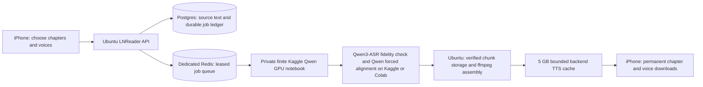

# Offline Qwen narration

Implementation record: 19 October 2026. This supersedes the initial research plan. Ubuntu starts with fresh accounts and an empty library. There is no Render account migration.

## The intended daily flow

Open a book’s headphones action, select tomorrow’s chapter range, audition downloaded voice samples, select one or more narrators, and prepare. Each chapter and voice has its own preparation, transfer, and local availability state. The chapter manager provides per-voice playback, selection, pause, retry, deletion, voice filtering, and bulk deletion within a chapter range. A book has a preferred narrator, with per-chapter overrides.

Audio, the exact chapter text, and timing manifests live in Application Support on the phone. Explicit downloads have no automatic expiration. Deleting a voice preserves the chapter text and other voices. Server cache eviction does not modify phone files. A missing selected voice stops playback at the chapter boundary and offers preparation; the player does not change narrators automatically.

The reader retains its styling and adds a screenshot-inspired top title bar and lower chapter, scrubber, transport, speed, voice, download, bookmark, and sleep controls. Word highlighting uses the AVPlayer clock. Double tapping a word seeks to its aligned timestamp and resumes speech. Manual scrolling or selection suspends following. Back to current returns to the spoken word and restores following. Native long-press text selection remains available.

## Where each responsibility lives

Only `Qwen/Qwen3-TTS-12Hz-1.7B-CustomVoice` synthesizes speech. Inference runs exclusively on Kaggle CUDA. Ubuntu and the phone do not host a speech model. The checkpoint is pinned to `0c0e3051f131929182e2c023b9537f8b1c68adfe`. The nine preset voices are Ryan, Aiden, Vivian, Serena, Uncle Fu, Dylan, Eric, Anna, and Sohee. The picker labels native languages and English narration rather than implying all nine have a native English accent.

The model owns its tokenizer and waveform generation. The harness owns text extraction, speech normalization, sentence/clause chunking around 150–300 source characters, paragraph pauses, fidelity checks, alignment, hashing, assembly, and delivery. Number expansion can increase spoken length beyond the source length; oversized chapters can exceed the storage reservation and require shorter sections.

Web chapters and EPUBs use the same WKWebView text mapping as the reader. Unicode source offsets are UTF-16. PDF import uses selectable text, outline chapters or eight-page sections, repeated margin removal, page-number removal, and line joining. Image-only PDFs require a text layer. PDF cleanup is heuristic and requires document-specific review; it is not an OCR service.

## Durable queue and recovery

A chapter identity includes the owner, book, chapter, and canonical content revision. A rendition also includes the voice, model revision, and harness version. Repeated preparation deduplicates. Chunks have stable hashes; successful chunks checkpoint independently.

Postgres is authoritative for the source, pending work, attempts, lease, and completion. A transactional outbox feeds BullMQ. Reconciliation recreates queue entries after Redis loss. The dispatcher submits a private notebook only when work exists and a prior run is not queued or running. A launch cooldown prevents rapid notebook restarts after startup errors. Each run is finite: at most nine hours and 1,500 completed chunks.

Workers claim a 90-second lease, renew every ten seconds, and checkpoint verified FLAC and timings. Attempt-specific paths and lease tokens prevent stale workers from overwriting accepted output. Three failed attempts produce a visible failure and explicit retry. Pending queue windows are bounded. First-selected voices precede additional voices; earlier submitted chapters are processed first within those priorities.

Kaggle availability and quota affect preparation time. A queued GPU notebook cannot provide an instant generation guarantee. Already downloaded playback remains independent of Kaggle and Ubuntu availability.

## Quality and timing contract

Speech normalization retains the source span for every spoken word. For example, both “forty” and “two” point to the original `42`. Seeking the displayed number chooses its first spoken word. No duration-per-character estimate drives highlighting.

On the selected Kaggle or Colab CUDA worker, Qwen3-ASR transcribes the delivered waveform independently for fidelity checking. Excessive word error rate, omitted words, incorrect numbers and repeated phrases are rejected. Qwen3-ForcedAligner separately aligns the expected wording. Sound timings are kept; collapsed, missing or crossed timestamps are repaired from nearby measured anchors, with a monotonic proportional approximation if no usable anchors remain. This affects highlights and seeks only: independently detected missing speech is still rejected. A CPU repair avoids regenerating good audio or spending an extra GPU alignment pass. TTS and ASR use separate pinned Python environments to preserve their supported Transformers versions. The backend validates source spans, monotonic timing, FLAC checksums, duration, sample rate, and channels.

Ubuntu adds explicit paragraph pauses, assembles PCM with ffmpeg, normalizes loudness, and produces mono 24 kHz AAC at approximately 64 kbps in a chapter M4A. Final duration and word timing are checked after encoding. One chapter per file supplies the chapter boundary; a whole-book M4B export has not been implemented.

The phone verifies SHA-256, byte count, duration, and manifest bounds before committing a package. Background URLSession transfers support resume, Wi-Fi-only requests, independent transfer identities, and stale callback rejection. A launch scan recovers committed packages after an interrupted index write. Playback speed changes use the existing local file. Audio interruptions, headphones, lock-screen controls, sleep timers, listening positions, and downloaded next chapters are handled by the app-owned player.

## The 5 GB backend budget

The configured ceiling is **5,000,000,000 bytes** across TTS payload files, measured TTS database relation storage, Redis memory, and 128 MB reserved for persistence rewrites, bounded logs, and database overhead. This is the TTS application-data budget; host software, Docker images, and unrelated applications are outside it.

Before uploads and assembly, the API reserves enough space for concurrent writes and temporary PCM/AAC files. It evicts least recently used completed, failed, or cancelled renditions, excluding active HTTP readers and the current preparation. Voice previews receive retention preference but can also be evicted. After final commit, disposable FLAC and PCM intermediates are removed. Stale uploads and orphaned directories are collected. Redis uses a 32 MB `noeviction` ceiling so cache pressure does not silently remove live job locks. Completed and failed queue records, tombstones, notebook launch files, and logs have bounded retention.

Eviction removes server audio and chunk records and leaves a bounded regeneration tombstone. Prepare or Retry rebuilds the same immutable rendition from source. If every remaining file is active, new writes stop with an error instead of growing storage. No extra audio-backup directory bypasses the budget. Persistent Postgres, Redis AOF, and filesystem volumes survive container restarts; an off-host disaster-recovery backup is not configured.

The volume has one API owner. Multiple API replicas would require a shared reservation/eviction lock before deployment.

## Deployment and validation

API: `https://lnreader.traverses.dpdns.org`. Private notebook: `https://www.kaggle.com/code/ca5qee1/lnreader-qwen-offline-narration`. Kaggle credentials are outside both repositories and available only to the backend dispatcher; the notebook receives an expiring worker token.

The backend test suite covers original auth/sync, text spans and chunking, ownership and worker authorization, idempotent preparation, Redis reconstruction, expired/stale leases, actual ffmpeg packaging, cache reservations, pinned readers, and eviction/regeneration. Python tests cover fidelity rejection and refusal to infer outside Kaggle. `scripts/check-tts-contracts.sh` tests Swift timing contracts and actual WKWebView extraction on macOS.

Public HTTPS signup, catalogue, preparation, isolation, and storage smoke checks passed. The updated iOS app passes a normal unsigned generic-simulator build, including Glur Metal shader compilation, after the Apple Metal Toolchain became available. No dependency workaround remains in the checkout. Physical iPhone layout/playback verification and a signed device build remain required.

The October 19 investigation found that overnight runs failed before claiming work because package installation modified an already-loaded Python 3.13 notebook kernel. The replacement bootstrap installs a pinned Python 3.12 runtime in a separate process; its CPU import preflight passed. Run v36 has reached Qwen GPU generation and uploaded verified source-aligned chunks for real queued book chapters. Some generated parts failed fidelity/alignment checks and were retried. Controlled validation v3 subsequently produced all 12 packages: baseline, two-paragraph narrative, numbers/dates, and all nine voice previews. Public HTTPS checks verified authenticated download, SHA-256, AAC duration, byte ranges and paragraph pauses. Apple AVFoundation fully decoded all 12 downloaded packages offline and verified media-clock/source seeks. This validates short real generated samples, not a complete audiobook or physical-phone session.

The dispatcher now publishes an authenticated engine status with a heartbeat, explicit GPU wait/startup/retry/paused/unavailable states and retry time. Three failed launches per runtime revision pause automatic retries. Startup diagnostics are classified into fixed explanations so notebook source and credentials never reach the phone. Per-chunk retry warnings and failed renditions are visible to iOS; successful refreshes clear stale connection errors. Public HTTPS smoke checks cover status authentication and JSON request errors.

The offline audio sheet uses horizontal SF Symbol action cards, direct chapter-number range entry, chapter-title/number search, state and voice filters, and lazy List rows. Only one chapter expands into per-voice actions at a time. Bulk deletion applies to the selected range and voice filter; phone copies remain persistent. The shared app theme, asset accent, root tint, reader highlights and remaining action/link accents use Apple Music inspired #FA2D48.

The pinned 4.55 GB Qwen checkpoint was transferred from Hugging Face through bounded production RAM directly into the private Kaggle Model ca5qee1/lnreader-qwen3-tts/pyTorch/customvoice-pinned/1, without storing weights on Ubuntu disk or downloading them through the Mac. A metadata-only publisher waits for Kaggle's extracted files before making the attachment available to future batches. Mounted checkpoints are verified against pinned provenance and every file checksum before Qwen loads. The transfer and extraction completed, and validation v3 loaded the verified attached checkpoint. Model storage is on Kaggle and is separate from the Ubuntu audio cache.

All nine previews passed automatic fidelity/alignment and real download/Apple offline-decoding checks. Listening review on the target iPhone, full physical-phone playback, and measured timing accuracy remain pending. No synthesis speed, GPU capacity, word-accuracy, or zero-gap playback benchmark is claimed.

Release acceptance targets: downloaded chapter starts within 300 ms on the target phone; double-tap seeks within 150 ms of the verified word boundary; highlighting remains within 150 ms at supported playback rates; a 30-minute airplane-mode session survives lock/unlock and app relaunch; interrupted and duplicate transfers cannot resurrect a deleted voice; cache pressure never alters downloaded phone copies. These are targets to measure, not recorded results.

## Library and chapter navigation update

Library reordering now uses a stable array of persistent book identifiers instead of swapping possibly identical saved positions. Dragging inserts a book and animates surrounding books; a repeated hover target is ignored. Drops and scene changes save a unique global order, including books hidden by a category/search. Custom ascending order is no longer reversed. Native SwiftUI zoom navigation matches library/browse covers to book details and chapter/Continue/history/update rows to the reader, with system return gestures and Reduce Motion support.

The detail screen keeps a small reading-progress overview and opens a dedicated chapter directory. The same directory is used inside the reader: groups of 50, range menu, previous/next, full-book search without the old 100-result truncation, unread/downloaded/bookmark filters, a current-chapter action, and direct chapter-number jumps that scroll to the target. Foundation contract checks cover stable moves and complete page coverage through 10,000 chapters. Physical-device animation/layout verification remains pending.

Persisted queue priorities from the old scheduler were found to outrank all newly scaled priorities, spreading generation across several chapters. Startup now migrates waiting, delayed and active jobs without interrupting active leases. A regression test covers a legacy job outside the normal 30-rendition reconciliation window and an active lease across restart. The backend suite has 48 passing tests.

## Final access and sheet corrections

Every `/api/tts` endpoint requires an authenticated account whose database username is `ca5`, including voice previews, manifests and signed audio downloads. Anonymous requests return 401; other signed-in accounts return 403 even with a valid asset URL or spoofed username header. Worker callbacks retain their separate scoped, expiring credentials. Real public HTTPS checks tested both denied cases against all 12 generated manifests and audio files. Validation created a dedicated short-lived ca5 session; it removed that session and the controlled test chapters afterward without changing the user's password, existing sessions or actual queued chapters.

The maintenance pause is cleared and the ordinary dispatcher is running. The download sheet initially selects only the current chapter and preferred voice. A separate This chapter action resets that choice; Next 10 and range selection require explicit action. Preparation status occupies its own grouped section, separated from the quick-action cards. The header uses the book cover from all entry points. Chapter rows inherit their grouped background, eliminating dark title rectangles; books with a single directory page omit pagination.

Sanitized live validation evidence is recorded in the backend's `deploy/tts-e2e-report.json`. Builds and contract checks pass. A physical iPhone was unavailable to the Mac, so device layout, interactive transitions, lock-screen playback and the stated latency targets remain unverified.

## Custom voice and provider controls

Add your own voice from Settings → Narration or the chapter download voice picker. Record or import 3–60 seconds (6 MB maximum), preview the recording locally, name it and optionally supply the exact transcript. The Rainbow Passage is selectable and has a Copy passage action. A blank transcript is filled by Qwen3-ASR on the remote worker. The custom narrator uses pinned Qwen3-TTS-12Hz-1.7B-Base, while presets use CustomVoice. The generated preview downloads automatically; chapter packages follow the same checksum/timing and offline playback path as presets. Voice references persist in Application Support and restore an evicted backend reference using its original checksum and ID.

The preparation provider picker selects Kaggle or Google Colab for new jobs and retries. Server credentials remain on Ubuntu. Model inference runs only on the selected remote CUDA provider. Provider-specific queues prevent one provider from claiming the other's jobs. A connected Colab account does not guarantee GPU availability. Current runtime status is polled rather than claiming audio is generating before a GPU is allocated.

Deleting chapter audio now deletes the phone files and all matching server generations, including every source revision, failed ledger, queue entries, chunks and cache. A durable deletion outbox handles offline deletion and must finish before preparing new audio. A fresh generation gets a new ID and cannot reuse old leases or corrupt resume data. Deletion keeps original book content, other chapters/voices and unrelated accounts. Deleting a voice profile removes its reference and cancels unfinished jobs, while already downloaded book audio remains playable.

## Listening presentation

Reading and listening share one top toolbar. Single-tapping the text switches between focused listening (text and highlights only, including no status bar or follow button) and visible controls. Double-tapping still seeks to a word without toggling focus. Focus changes also adjust the text viewport's reserved insets. Showing controls never overrides a manually detached scroll position; Back to current resumes following explicitly.

The player uses an inset rounded panel, with transport, progress, settings, bookmark, and a centered gradient voice chip. Download management stays in the voice menu. Only the currently spoken source word is highlighted; the paragraph anchor is transparent. Presets have distinct colors; new custom voices receive a random color that persists in UserDefaults. Download rows share the chip and show concise automatic retry status separately from final failures.

Final checks: listening single-tap focus, double-tap source seeking, viewport insets and detached following pass in real WKWebView. Five small real-Qwen packages passed offline Apple decoding, checksums and source timing checks. The final GPU synthesis was limited to the phone's 36-word failing section, which passed on attempt 1 with the number-homophone repair. Failed server preparations are reconciled after a server/device retry, while user-paused transfers remain paused.
