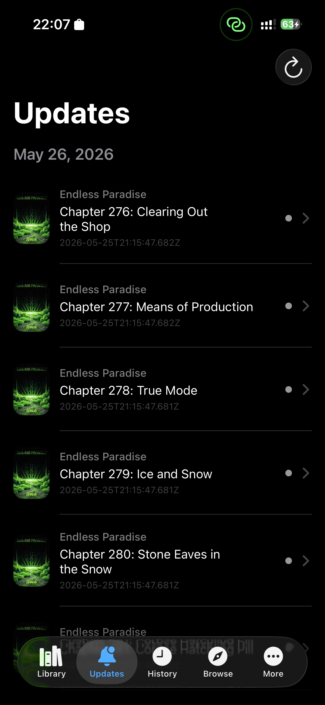
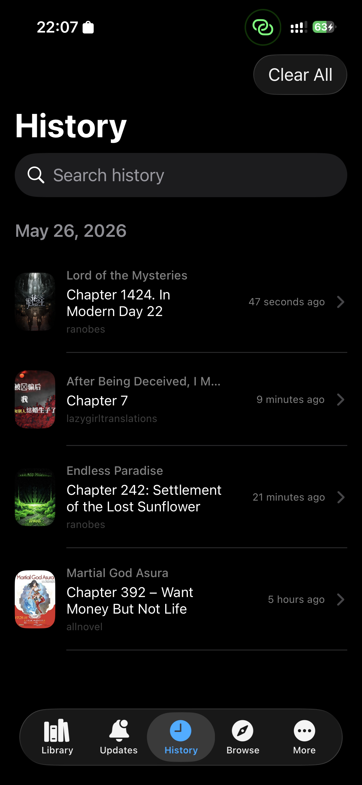
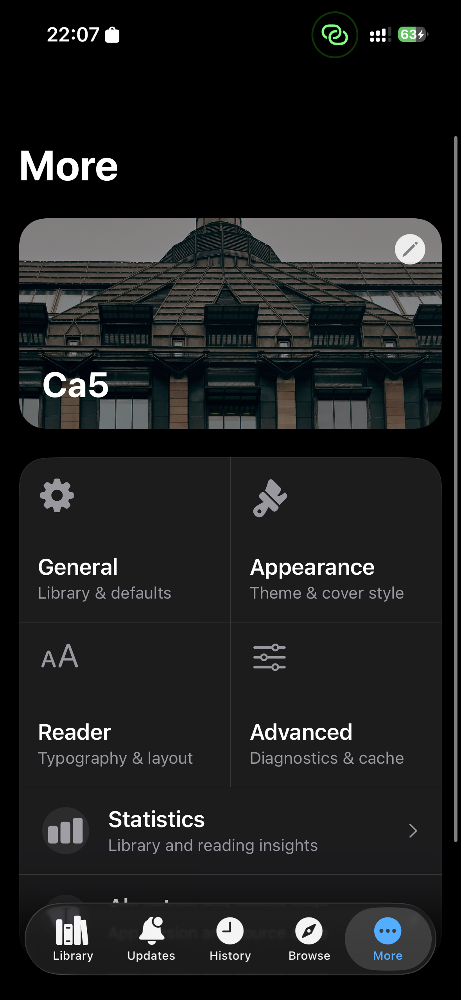

# LNReader for iOS

A native iOS reader for light novels and manga. SwiftUI and SwiftData throughout: a web
reader for novels, a pager and webtoon viewer for manga, chapter downloads that work offline,
AniList tracking, and on-device narration.

Every source is native Swift, compiled into the app. Light novels: Novel Fire, Novel Phoenix,
Ranobes, Free Web Novel. Manga: MangaFire, AllManga, Manhwa18, 4KHD, Omega Scans. Mihon,
Yokai and Tachimanga `.tachibk` backups import onto them.

This is not an App Store app. It is sideloaded or built from source with your own signing
identity.

## Screenshots

| | |
|---|---|
|  |  |
|  |  |

## Requirements

- **Xcode 26** with the iOS 26 SDK (deployment target is iOS 26.0).
- An iPhone or iPad on iOS 26 to run it on. The Simulator works for layout, but the reader,
  downloads and background tasks are only meaningful on a device.
- Your own Apple developer identity. Nothing signing-related is committed.

## Build and run

1. Copy the signing template and fill in your own values:

   ```sh
   cp Config/Local.xcconfig.example Config/Local.xcconfig
   ```

   Set `DEVELOPMENT_TEAM`, and set `BUNDLE_ID_SUFFIX` to something unique — free Apple IDs
   cannot share an App ID. `Config/Local.xcconfig` is git-ignored.

2. Open `LNReader.xcodeproj`, select your device, and Run.

Headless alternatives, from a normal terminal:

```sh
./scripts/build-ipa.sh release      # unsigned IPA, written to this folder
./scripts/install-release.sh        # build, install and launch on the first connected device
```

The IPA is unsigned; Sideloadly, AltStore or Xcode have to re-sign it. Both commands need a
normal terminal — `xcodebuild` resolves packages through `sandbox-exec`, which fails inside
restricted environments with `sandbox_apply: Operation not permitted`.

`project.yml` exists for XcodeGen, but the checked-in `LNReader.xcodeproj` is the build input;
XcodeGen is optional and not required to build.

## Scripts

| Command | What it does |
|---|---|
| `./scripts/typecheck.sh` | Compiles the whole app without Xcode or SwiftPM. The real compile check. |
| `./scripts/check.sh all` | Every headless behaviour check (~35 s). `check.sh` alone lists them, `check.sh <name>` runs one. |
| `./scripts/try-mangafire.sh` | Runs the MangaFire bundle against the live API. Needs network. |
| `./scripts/try-allmanga.sh` | Same for AllManga, including its `webview.capture` path. |
| `./scripts/profile-hotpaths.sh` | Library counts, progress writes and chapter rows at library scale. |
| `./scripts/profile-device.sh 30` | Release build on a device: hitch and Time Profiler trace. |

The checks are standalone programs in `tests/`, compiled against the few app files they touch.
There is no XCTest or SwiftPM test target, because package resolution and the Simulator are
not dependable in this environment; `typecheck.sh`'s header explains what fails and why.

## Layout

```
Models/Schema/     SchemaV1 — entries, chapters, history, categories, tracks, download queue
Models/Enums/      Library filters, sorts, badges, display modes
Features/          Library, Novel, MangaReader, Reader, Browse, History, Updates, More, Tracking
Services/          Sources (Native/ holds every site), Network, Images, Backup, downloads, TTS
Design/            Theme, control styles, shared view modifiers
Utilities/         Date parsing, HTML/XML, ZIP, gzip
tests/             Headless checks; scripts/check.sh compiles and runs them
docs/              Status ledger, performance numbers, feature notes
```

## Sources

- Each site is a `CatalogSource` in `Services/Sources/Native/`, registered by `NativeSources.all()`.
  Fixing a site means changing its Swift file and reinstalling the app.
- `scripts/try-native.sh` runs the sources against their live sites (`SOURCES=mangafire,ranobes`
  to pick some). It needs network access and is not part of `scripts/check.sh all`.
- The manga sources are ports of [keiyoushi/extensions-source](https://github.com/keiyoushi/extensions-source);
  the novel sources are ports of the LNReader plugins. Mihon source ids are computed in
  `NativeSourceIDs`, so a backup lands on the right source.

## Docs

- [AGENTS.md](AGENTS.md) — the rules and assumptions condensed from the docs below, for anyone
  (or any agent) about to change code.
- [docs/V2_PROGRESS.md](docs/V2_PROGRESS.md) — status of everything, open issues, next steps.
  Start here.
- [docs/PERFORMANCE.md](docs/PERFORMANCE.md) — measured hot paths and the rules that came out
  of them.
- [docs/OFFLINE_LIBRARY.md](docs/OFFLINE_LIBRARY.md) — downloads, background work, backup
  format, `.tachibk` import.
- [docs/MANGA_SUPPORT_PLAN.md](docs/MANGA_SUPPORT_PLAN.md) — architecture decisions that still
  constrain the code.
- [docs/LIBRARY_QUERY_PLAN.md](docs/LIBRARY_QUERY_PLAN.md) — proposed library data-flow
  rewrite.
- [docs/UI_AUDIT.md](docs/UI_AUDIT.md) and [docs/TTS_REVAMP_PLAN.md](docs/TTS_REVAMP_PLAN.md)
  are historical records, kept on purpose.

## Contributing

Branch `main`. Commits explain *why* and carry one logical change each. Before opening a pull
request, run:

```sh
./scripts/typecheck.sh
./scripts/check.sh all
```

If a new `.swift` file is added, it has to be added to the app target in
`LNReader.xcodeproj` — the project lists files individually, and a missing entry fails
silently. `plutil -lint LNReader.xcodeproj/project.pbxproj` validates the file afterwards.

Bug reports are most useful with the device, the iOS version, the build number from More →
About, and what the source was.

## Related repositories

- `lnreader-backend` — the narration pipeline and account services.
